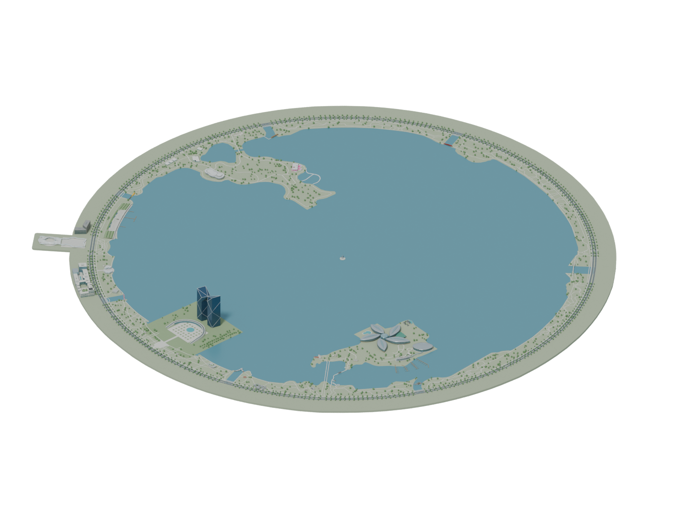

<p align="center"></p>

# 临港滴水湖区域数字模型

模型以可编辑的 Blender（`.blend`）文件提供，可用于影视制作中的镜头预演，以及交互游戏、应用等三维场景开发。

应用示例：[iOS App《成长小镇》中的模型应用与视频渲染效果](https://www.bilibili.com/video/BV1fYnS6xEax/)。

以临港滴水湖及第一圈环湖区域为范围，复原湖面、岛屿、道路、典型建筑、桥梁及示意绿化。优先表达位置关系、建筑轮廓、比例、屋顶形态和主要材质，面向中远距离展示与后续三维应用。



## 项目内容

- 1 个链接主场景，组装 27 组建筑与地标、9 座桥梁。
- 36 个独立 Blender 模型，每个模型与预览、参考来源清单放在同一文件夹。
- [40 页项目介绍与逐模型图册（PDF）](%E4%B8%B4%E6%B8%AF%E6%BB%B4%E6%B0%B4%E6%B9%96_%E6%A8%A1%E5%9E%8B%E9%A1%B9%E7%9B%AE%E4%BB%8B%E7%BB%8D%E4%B8%8E%E5%9B%BE%E5%86%8C.pdf)。

## 获取与使用

所有 `.blend` 文件均通过 Git LFS 管理。先安装 [Git LFS](https://git-lfs.com/)，再下载：

```bash
git lfs install
git clone https://github.com/scienith/linggang-blender-models.git
cd linggang-blender-models
git lfs pull
```

建议用 Blender 4.5 或更新版本打开 `models/dishui-lake.blend`。请保留整个 `models/` 目录，主场景通过相对路径加载独立建筑和桥梁。

单独编辑时，直接打开对应 `.blend`，保留原区域坐标；保存后重新打开主场景或重载对应 Library 即可读取更新。每个独立文件包含查看相机与灯光。

## 模型目录

| 模型 | Blender 文件 | 预览 | 参考来源 |
| --- | --- | --- | --- |
| 临港滴水湖完整区域 | [打开路径](models/dishui-lake.blend) | [查看](docs/%E4%B8%BB%E5%9C%BA%E6%99%AF%E9%A2%84%E8%A7%88.png) | [来源清单](models/%E4%B8%BB%E5%9C%BA%E6%99%AF%E5%8F%82%E8%80%83%E8%B5%84%E6%96%99/README.md) |
| 中银金融中心 | [打开路径](models/buildings/%E4%B8%AD%E9%93%B6%E9%87%91%E8%9E%8D%E4%B8%AD%E5%BF%83/%E4%B8%AD%E9%93%B6%E9%87%91%E8%9E%8D%E4%B8%AD%E5%BF%83.blend) | [查看](models/buildings/%E4%B8%AD%E9%93%B6%E9%87%91%E8%9E%8D%E4%B8%AD%E5%BF%83/%E9%A2%84%E8%A7%88.png) | [来源清单](models/buildings/%E4%B8%AD%E9%93%B6%E9%87%91%E8%9E%8D%E4%B8%AD%E5%BF%83/%E5%8F%82%E8%80%83%E8%B5%84%E6%96%99/README.md) |
| 云朵建筑北楼 | [打开路径](models/buildings/%E4%BA%91%E6%9C%B5%E5%BB%BA%E7%AD%91%E5%8C%97%E6%A5%BC/%E4%BA%91%E6%9C%B5%E5%BB%BA%E7%AD%91%E5%8C%97%E6%A5%BC.blend) | [查看](models/buildings/%E4%BA%91%E6%9C%B5%E5%BB%BA%E7%AD%91%E5%8C%97%E6%A5%BC/%E9%A2%84%E8%A7%88.png) | [来源清单](models/buildings/%E4%BA%91%E6%9C%B5%E5%BB%BA%E7%AD%91%E5%8C%97%E6%A5%BC/%E5%8F%82%E8%80%83%E8%B5%84%E6%96%99/README.md) |
| 云朵建筑南楼 | [打开路径](models/buildings/%E4%BA%91%E6%9C%B5%E5%BB%BA%E7%AD%91%E5%8D%97%E6%A5%BC/%E4%BA%91%E6%9C%B5%E5%BB%BA%E7%AD%91%E5%8D%97%E6%A5%BC.blend) | [查看](models/buildings/%E4%BA%91%E6%9C%B5%E5%BB%BA%E7%AD%91%E5%8D%97%E6%A5%BC/%E9%A2%84%E8%A7%88.png) | [来源清单](models/buildings/%E4%BA%91%E6%9C%B5%E5%BB%BA%E7%AD%91%E5%8D%97%E6%A5%BC/%E5%8F%82%E8%80%83%E8%B5%84%E6%96%99/README.md) |
| 倚石苑 | [打开路径](models/buildings/%E5%80%9A%E7%9F%B3%E8%8B%91/%E5%80%9A%E7%9F%B3%E8%8B%91.blend) | [查看](models/buildings/%E5%80%9A%E7%9F%B3%E8%8B%91/%E9%A2%84%E8%A7%88.png) | [来源清单](models/buildings/%E5%80%9A%E7%9F%B3%E8%8B%91/%E5%8F%82%E8%80%83%E8%B5%84%E6%96%99/README.md) |
| 北岛三连方亭 | [打开路径](models/buildings/%E5%8C%97%E5%B2%9B%E4%B8%89%E8%BF%9E%E6%96%B9%E4%BA%AD/%E5%8C%97%E5%B2%9B%E4%B8%89%E8%BF%9E%E6%96%B9%E4%BA%AD.blend) | [查看](models/buildings/%E5%8C%97%E5%B2%9B%E4%B8%89%E8%BF%9E%E6%96%B9%E4%BA%AD/%E9%A2%84%E8%A7%88.png) | [来源清单](models/buildings/%E5%8C%97%E5%B2%9B%E4%B8%89%E8%BF%9E%E6%96%B9%E4%BA%AD/%E5%8F%82%E8%80%83%E8%B5%84%E6%96%99/README.md) |
| 北岛露天看台 | [打开路径](models/buildings/%E5%8C%97%E5%B2%9B%E9%9C%B2%E5%A4%A9%E7%9C%8B%E5%8F%B0/%E5%8C%97%E5%B2%9B%E9%9C%B2%E5%A4%A9%E7%9C%8B%E5%8F%B0.blend) | [查看](models/buildings/%E5%8C%97%E5%B2%9B%E9%9C%B2%E5%A4%A9%E7%9C%8B%E5%8F%B0/%E9%A2%84%E8%A7%88.png) | [来源清单](models/buildings/%E5%8C%97%E5%B2%9B%E9%9C%B2%E5%A4%A9%E7%9C%8B%E5%8F%B0/%E5%8F%82%E8%80%83%E8%B5%84%E6%96%99/README.md) |
| 北岛东侧网格长亭 | [打开路径](models/buildings/%E5%8C%97%E5%B2%9B%E4%B8%9C%E4%BE%A7%E7%BD%91%E6%A0%BC%E9%95%BF%E4%BA%AD/%E5%8C%97%E5%B2%9B%E4%B8%9C%E4%BE%A7%E7%BD%91%E6%A0%BC%E9%95%BF%E4%BA%AD.blend) | [查看](models/buildings/%E5%8C%97%E5%B2%9B%E4%B8%9C%E4%BE%A7%E7%BD%91%E6%A0%BC%E9%95%BF%E4%BA%AD/%E9%A2%84%E8%A7%88.png) | [来源清单](models/buildings/%E5%8C%97%E5%B2%9B%E4%B8%9C%E4%BE%A7%E7%BD%91%E6%A0%BC%E9%95%BF%E4%BA%AD/%E5%8F%82%E8%80%83%E8%B5%84%E6%96%99/README.md) |
| 北岛双屋面建筑 | [打开路径](models/buildings/%E5%8C%97%E5%B2%9B%E5%8F%8C%E5%B1%8B%E9%9D%A2%E5%BB%BA%E7%AD%91/%E5%8C%97%E5%B2%9B%E5%8F%8C%E5%B1%8B%E9%9D%A2%E5%BB%BA%E7%AD%91.blend) | [查看](models/buildings/%E5%8C%97%E5%B2%9B%E5%8F%8C%E5%B1%8B%E9%9D%A2%E5%BB%BA%E7%AD%91/%E9%A2%84%E8%A7%88.png) | [来源清单](models/buildings/%E5%8C%97%E5%B2%9B%E5%8F%8C%E5%B1%8B%E9%9D%A2%E5%BB%BA%E7%AD%91/%E5%8F%82%E8%80%83%E8%B5%84%E6%96%99/README.md) |
| 北岛独立矩形建筑 | [打开路径](models/buildings/%E5%8C%97%E5%B2%9B%E7%8B%AC%E7%AB%8B%E7%9F%A9%E5%BD%A2%E5%BB%BA%E7%AD%91/%E5%8C%97%E5%B2%9B%E7%8B%AC%E7%AB%8B%E7%9F%A9%E5%BD%A2%E5%BB%BA%E7%AD%91.blend) | [查看](models/buildings/%E5%8C%97%E5%B2%9B%E7%8B%AC%E7%AB%8B%E7%9F%A9%E5%BD%A2%E5%BB%BA%E7%AD%91/%E9%A2%84%E8%A7%88.png) | [来源清单](models/buildings/%E5%8C%97%E5%B2%9B%E7%8B%AC%E7%AB%8B%E7%9F%A9%E5%BD%A2%E5%BB%BA%E7%AD%91/%E5%8F%82%E8%80%83%E8%B5%84%E6%96%99/README.md) |
| 南岛东侧白叶建筑 | [打开路径](models/buildings/%E5%8D%97%E5%B2%9B%E4%B8%9C%E4%BE%A7%E7%99%BD%E5%8F%B6%E5%BB%BA%E7%AD%91/%E5%8D%97%E5%B2%9B%E4%B8%9C%E4%BE%A7%E7%99%BD%E5%8F%B6%E5%BB%BA%E7%AD%91.blend) | [查看](models/buildings/%E5%8D%97%E5%B2%9B%E4%B8%9C%E4%BE%A7%E7%99%BD%E5%8F%B6%E5%BB%BA%E7%AD%91/%E9%A2%84%E8%A7%88.png) | [来源清单](models/buildings/%E5%8D%97%E5%B2%9B%E4%B8%9C%E4%BE%A7%E7%99%BD%E5%8F%B6%E5%BB%BA%E7%AD%91/%E5%8F%82%E8%80%83%E8%B5%84%E6%96%99/README.md) |
| 南岛东北岸中式院落组团 | [打开路径](models/buildings/%E5%8D%97%E5%B2%9B%E4%B8%9C%E5%8C%97%E5%B2%B8%E4%B8%AD%E5%BC%8F%E9%99%A2%E8%90%BD%E7%BB%84%E5%9B%A2/%E5%8D%97%E5%B2%9B%E4%B8%9C%E5%8C%97%E5%B2%B8%E4%B8%AD%E5%BC%8F%E9%99%A2%E8%90%BD%E7%BB%84%E5%9B%A2.blend) | [查看](models/buildings/%E5%8D%97%E5%B2%9B%E4%B8%9C%E5%8C%97%E5%B2%B8%E4%B8%AD%E5%BC%8F%E9%99%A2%E8%90%BD%E7%BB%84%E5%9B%A2/%E9%A2%84%E8%A7%88.png) | [来源清单](models/buildings/%E5%8D%97%E5%B2%9B%E4%B8%9C%E5%8C%97%E5%B2%B8%E4%B8%AD%E5%BC%8F%E9%99%A2%E8%90%BD%E7%BB%84%E5%9B%A2/%E5%8F%82%E8%80%83%E8%B5%84%E6%96%99/README.md) |
| 南岛入口三连灰顶建筑 | [打开路径](models/buildings/%E5%8D%97%E5%B2%9B%E5%85%A5%E5%8F%A3%E4%B8%89%E8%BF%9E%E7%81%B0%E9%A1%B6%E5%BB%BA%E7%AD%91/%E5%8D%97%E5%B2%9B%E5%85%A5%E5%8F%A3%E4%B8%89%E8%BF%9E%E7%81%B0%E9%A1%B6%E5%BB%BA%E7%AD%91.blend) | [查看](models/buildings/%E5%8D%97%E5%B2%9B%E5%85%A5%E5%8F%A3%E4%B8%89%E8%BF%9E%E7%81%B0%E9%A1%B6%E5%BB%BA%E7%AD%91/%E9%A2%84%E8%A7%88.png) | [来源清单](models/buildings/%E5%8D%97%E5%B2%9B%E5%85%A5%E5%8F%A3%E4%B8%89%E8%BF%9E%E7%81%B0%E9%A1%B6%E5%BB%BA%E7%AD%91/%E5%8F%82%E8%80%83%E8%B5%84%E6%96%99/README.md) |
| 南岛游艇俱乐部 | [打开路径](models/buildings/%E5%8D%97%E5%B2%9B%E6%B8%B8%E8%89%87%E4%BF%B1%E4%B9%90%E9%83%A8/%E5%8D%97%E5%B2%9B%E6%B8%B8%E8%89%87%E4%BF%B1%E4%B9%90%E9%83%A8.blend) | [查看](models/buildings/%E5%8D%97%E5%B2%9B%E6%B8%B8%E8%89%87%E4%BF%B1%E4%B9%90%E9%83%A8/%E9%A2%84%E8%A7%88.png) | [来源清单](models/buildings/%E5%8D%97%E5%B2%9B%E6%B8%B8%E8%89%87%E4%BF%B1%E4%B9%90%E9%83%A8/%E5%8F%82%E8%80%83%E8%B5%84%E6%96%99/README.md) |
| 南岛西侧红叶建筑 | [打开路径](models/buildings/%E5%8D%97%E5%B2%9B%E8%A5%BF%E4%BE%A7%E7%BA%A2%E5%8F%B6%E5%BB%BA%E7%AD%91/%E5%8D%97%E5%B2%9B%E8%A5%BF%E4%BE%A7%E7%BA%A2%E5%8F%B6%E5%BB%BA%E7%AD%91.blend) | [查看](models/buildings/%E5%8D%97%E5%B2%9B%E8%A5%BF%E4%BE%A7%E7%BA%A2%E5%8F%B6%E5%BB%BA%E7%AD%91/%E9%A2%84%E8%A7%88.png) | [来源清单](models/buildings/%E5%8D%97%E5%B2%9B%E8%A5%BF%E4%BE%A7%E7%BA%A2%E5%8F%B6%E5%BB%BA%E7%AD%91/%E5%8F%82%E8%80%83%E8%B5%84%E6%96%99/README.md) |
| 明叶轩 | [打开路径](models/buildings/%E6%98%8E%E5%8F%B6%E8%BD%A9/%E6%98%8E%E5%8F%B6%E8%BD%A9.blend) | [查看](models/buildings/%E6%98%8E%E5%8F%B6%E8%BD%A9/%E9%A2%84%E8%A7%88.png) | [来源清单](models/buildings/%E6%98%8E%E5%8F%B6%E8%BD%A9/%E5%8F%82%E8%80%83%E8%B5%84%E6%96%99/README.md) |
| 港城国贸中心 | [打开路径](models/buildings/%E6%B8%AF%E5%9F%8E%E5%9B%BD%E8%B4%B8%E4%B8%AD%E5%BF%83/%E6%B8%AF%E5%9F%8E%E5%9B%BD%E8%B4%B8%E4%B8%AD%E5%BF%83.blend) | [查看](models/buildings/%E6%B8%AF%E5%9F%8E%E5%9B%BD%E8%B4%B8%E4%B8%AD%E5%BF%83/%E9%A2%84%E8%A7%88.png) | [来源清单](models/buildings/%E6%B8%AF%E5%9F%8E%E5%9B%BD%E8%B4%B8%E4%B8%AD%E5%BF%83/%E5%8F%82%E8%80%83%E8%B5%84%E6%96%99/README.md) |
| 港城大厦 | [打开路径](models/buildings/%E6%B8%AF%E5%9F%8E%E5%A4%A7%E5%8E%A6/%E6%B8%AF%E5%9F%8E%E5%A4%A7%E5%8E%A6.blend) | [查看](models/buildings/%E6%B8%AF%E5%9F%8E%E5%A4%A7%E5%8E%A6/%E9%A2%84%E8%A7%88.png) | [来源清单](models/buildings/%E6%B8%AF%E5%9F%8E%E5%A4%A7%E5%8E%A6/%E5%8F%82%E8%80%83%E8%B5%84%E6%96%99/README.md) |
| 湖心雕塑 | [打开路径](models/buildings/%E6%B9%96%E5%BF%83%E9%9B%95%E5%A1%91/%E6%B9%96%E5%BF%83%E9%9B%95%E5%A1%91.blend) | [查看](models/buildings/%E6%B9%96%E5%BF%83%E9%9B%95%E5%A1%91/%E9%A2%84%E8%A7%88.png) | [来源清单](models/buildings/%E6%B9%96%E5%BF%83%E9%9B%95%E5%A1%91/%E5%8F%82%E8%80%83%E8%B5%84%E6%96%99/README.md) |
| 滴水云厅 | [打开路径](models/buildings/%E6%BB%B4%E6%B0%B4%E4%BA%91%E5%8E%85/%E6%BB%B4%E6%B0%B4%E4%BA%91%E5%8E%85.blend) | [查看](models/buildings/%E6%BB%B4%E6%B0%B4%E4%BA%91%E5%8E%85/%E9%A2%84%E8%A7%88.png) | [来源清单](models/buildings/%E6%BB%B4%E6%B0%B4%E4%BA%91%E5%8E%85/%E5%8F%82%E8%80%83%E8%B5%84%E6%96%99/README.md) |
| 滴水湖一号码头 | [打开路径](models/buildings/%E6%BB%B4%E6%B0%B4%E6%B9%96%E4%B8%80%E5%8F%B7%E7%A0%81%E5%A4%B4/%E6%BB%B4%E6%B0%B4%E6%B9%96%E4%B8%80%E5%8F%B7%E7%A0%81%E5%A4%B4.blend) | [查看](models/buildings/%E6%BB%B4%E6%B0%B4%E6%B9%96%E4%B8%80%E5%8F%B7%E7%A0%81%E5%A4%B4/%E9%A2%84%E8%A7%88.png) | [来源清单](models/buildings/%E6%BB%B4%E6%B0%B4%E6%B9%96%E4%B8%80%E5%8F%B7%E7%A0%81%E5%A4%B4/%E5%8F%82%E8%80%83%E8%B5%84%E6%96%99/README.md) |
| 滴水湖会议中心 | [打开路径](models/buildings/%E6%BB%B4%E6%B0%B4%E6%B9%96%E4%BC%9A%E8%AE%AE%E4%B8%AD%E5%BF%83/%E6%BB%B4%E6%B0%B4%E6%B9%96%E4%BC%9A%E8%AE%AE%E4%B8%AD%E5%BF%83.blend) | [查看](models/buildings/%E6%BB%B4%E6%B0%B4%E6%B9%96%E4%BC%9A%E8%AE%AE%E4%B8%AD%E5%BF%83/%E9%A2%84%E8%A7%88.png) | [来源清单](models/buildings/%E6%BB%B4%E6%B0%B4%E6%B9%96%E4%BC%9A%E8%AE%AE%E4%B8%AD%E5%BF%83/%E5%8F%82%E8%80%83%E8%B5%84%E6%96%99/README.md) |
| 滴水湖洲际酒店 | [打开路径](models/buildings/%E6%BB%B4%E6%B0%B4%E6%B9%96%E6%B4%B2%E9%99%85%E9%85%92%E5%BA%97/%E6%BB%B4%E6%B0%B4%E6%B9%96%E6%B4%B2%E9%99%85%E9%85%92%E5%BA%97.blend) | [查看](models/buildings/%E6%BB%B4%E6%B0%B4%E6%B9%96%E6%B4%B2%E9%99%85%E9%85%92%E5%BA%97/%E9%A2%84%E8%A7%88.png) | [来源清单](models/buildings/%E6%BB%B4%E6%B0%B4%E6%B9%96%E6%B4%B2%E9%99%85%E9%85%92%E5%BA%97/%E5%8F%82%E8%80%83%E8%B5%84%E6%96%99/README.md) |
| 滴水湖站广场 | [打开路径](models/buildings/%E6%BB%B4%E6%B0%B4%E6%B9%96%E7%AB%99%E5%B9%BF%E5%9C%BA/%E6%BB%B4%E6%B0%B4%E6%B9%96%E7%AB%99%E5%B9%BF%E5%9C%BA.blend) | [查看](models/buildings/%E6%BB%B4%E6%B0%B4%E6%B9%96%E7%AB%99%E5%B9%BF%E5%9C%BA/%E9%A2%84%E8%A7%88.png) | [来源清单](models/buildings/%E6%BB%B4%E6%B0%B4%E6%B9%96%E7%AB%99%E5%B9%BF%E5%9C%BA/%E5%8F%82%E8%80%83%E8%B5%84%E6%96%99/README.md) |
| 白色钟塔 | [打开路径](models/buildings/%E7%99%BD%E8%89%B2%E9%92%9F%E5%A1%94/%E7%99%BD%E8%89%B2%E9%92%9F%E5%A1%94.blend) | [查看](models/buildings/%E7%99%BD%E8%89%B2%E9%92%9F%E5%A1%94/%E9%A2%84%E8%A7%88.png) | [来源清单](models/buildings/%E7%99%BD%E8%89%B2%E9%92%9F%E5%A1%94/%E5%8F%82%E8%80%83%E8%B5%84%E6%96%99/README.md) |
| 站广场东侧L形办公楼 | [打开路径](models/buildings/%E7%AB%99%E5%B9%BF%E5%9C%BA%E4%B8%9C%E4%BE%A7L%E5%BD%A2%E5%8A%9E%E5%85%AC%E6%A5%BC/%E7%AB%99%E5%B9%BF%E5%9C%BA%E4%B8%9C%E4%BE%A7L%E5%BD%A2%E5%8A%9E%E5%85%AC%E6%A5%BC.blend) | [查看](models/buildings/%E7%AB%99%E5%B9%BF%E5%9C%BA%E4%B8%9C%E4%BE%A7L%E5%BD%A2%E5%8A%9E%E5%85%AC%E6%A5%BC/%E9%A2%84%E8%A7%88.png) | [来源清单](models/buildings/%E7%AB%99%E5%B9%BF%E5%9C%BA%E4%B8%9C%E4%BE%A7L%E5%BD%A2%E5%8A%9E%E5%85%AC%E6%A5%BC/%E5%8F%82%E8%80%83%E8%B5%84%E6%96%99/README.md) |
| 绿丽港音乐盒子 | [打开路径](models/buildings/%E7%BB%BF%E4%B8%BD%E6%B8%AF%E9%9F%B3%E4%B9%90%E7%9B%92%E5%AD%90/%E7%BB%BF%E4%B8%BD%E6%B8%AF%E9%9F%B3%E4%B9%90%E7%9B%92%E5%AD%90.blend) | [查看](models/buildings/%E7%BB%BF%E4%B8%BD%E6%B8%AF%E9%9F%B3%E4%B9%90%E7%9B%92%E5%AD%90/%E9%A2%84%E8%A7%88.png) | [来源清单](models/buildings/%E7%BB%BF%E4%B8%BD%E6%B8%AF%E9%9F%B3%E4%B9%90%E7%9B%92%E5%AD%90/%E5%8F%82%E8%80%83%E8%B5%84%E6%96%99/README.md) |
| 西北岸圆亭 | [打开路径](models/buildings/%E8%A5%BF%E5%8C%97%E5%B2%B8%E5%9C%86%E4%BA%AD/%E8%A5%BF%E5%8C%97%E5%B2%B8%E5%9C%86%E4%BA%AD.blend) | [查看](models/buildings/%E8%A5%BF%E5%8C%97%E5%B2%B8%E5%9C%86%E4%BA%AD/%E9%A2%84%E8%A7%88.png) | [来源清单](models/buildings/%E8%A5%BF%E5%8C%97%E5%B2%B8%E5%9C%86%E4%BA%AD/%E5%8F%82%E8%80%83%E8%B5%84%E6%96%99/README.md) |
| 北岛浮桥 | [打开路径](models/bridges/%E5%8C%97%E5%B2%9B%E6%B5%AE%E6%A1%A5/%E5%8C%97%E5%B2%9B%E6%B5%AE%E6%A1%A5.blend) | [查看](models/bridges/%E5%8C%97%E5%B2%9B%E6%B5%AE%E6%A1%A5/%E9%A2%84%E8%A7%88.png) | [来源清单](models/bridges/%E5%8C%97%E5%B2%9B%E6%B5%AE%E6%A1%A5/%E5%8F%82%E8%80%83%E8%B5%84%E6%96%99/README.md) |
| 南岛古典廊桥 | [打开路径](models/bridges/%E5%8D%97%E5%B2%9B%E5%8F%A4%E5%85%B8%E5%BB%8A%E6%A1%A5/%E5%8D%97%E5%B2%9B%E5%8F%A4%E5%85%B8%E5%BB%8A%E6%A1%A5.blend) | [查看](models/bridges/%E5%8D%97%E5%B2%9B%E5%8F%A4%E5%85%B8%E5%BB%8A%E6%A1%A5/%E9%A2%84%E8%A7%88.png) | [来源清单](models/bridges/%E5%8D%97%E5%B2%9B%E5%8F%A4%E5%85%B8%E5%BB%8A%E6%A1%A5/%E5%8F%82%E8%80%83%E8%B5%84%E6%96%99/README.md) |
| 橙卉桥 | [打开路径](models/bridges/%E6%A9%99%E5%8D%89%E6%A1%A5/%E6%A9%99%E5%8D%89%E6%A1%A5.blend) | [查看](models/bridges/%E6%A9%99%E5%8D%89%E6%A1%A5/%E9%A2%84%E8%A7%88.png) | [来源清单](models/bridges/%E6%A9%99%E5%8D%89%E6%A1%A5/%E5%8F%82%E8%80%83%E8%B5%84%E6%96%99/README.md) |
| 紫浪桥 | [打开路径](models/bridges/%E7%B4%AB%E6%B5%AA%E6%A1%A5/%E7%B4%AB%E6%B5%AA%E6%A1%A5.blend) | [查看](models/bridges/%E7%B4%AB%E6%B5%AA%E6%A1%A5/%E9%A2%84%E8%A7%88.png) | [来源清单](models/bridges/%E7%B4%AB%E6%B5%AA%E6%A1%A5/%E5%8F%82%E8%80%83%E8%B5%84%E6%96%99/README.md) |
| 绿荷桥 | [打开路径](models/bridges/%E7%BB%BF%E8%8D%B7%E6%A1%A5/%E7%BB%BF%E8%8D%B7%E6%A1%A5.blend) | [查看](models/bridges/%E7%BB%BF%E8%8D%B7%E6%A1%A5/%E9%A2%84%E8%A7%88.png) | [来源清单](models/bridges/%E7%BB%BF%E8%8D%B7%E6%A1%A5/%E5%8F%82%E8%80%83%E8%B5%84%E6%96%99/README.md) |
| 蓝藻桥 | [打开路径](models/bridges/%E8%93%9D%E8%97%BB%E6%A1%A5/%E8%93%9D%E8%97%BB%E6%A1%A5.blend) | [查看](models/bridges/%E8%93%9D%E8%97%BB%E6%A1%A5/%E9%A2%84%E8%A7%88.png) | [来源清单](models/bridges/%E8%93%9D%E8%97%BB%E6%A1%A5/%E5%8F%82%E8%80%83%E8%B5%84%E6%96%99/README.md) |
| 赤黾桥 | [打开路径](models/bridges/%E8%B5%A4%E9%BB%BE%E6%A1%A5/%E8%B5%A4%E9%BB%BE%E6%A1%A5.blend) | [查看](models/bridges/%E8%B5%A4%E9%BB%BE%E6%A1%A5/%E9%A2%84%E8%A7%88.png) | [来源清单](models/bridges/%E8%B5%A4%E9%BB%BE%E6%A1%A5/%E5%8F%82%E8%80%83%E8%B5%84%E6%96%99/README.md) |
| 青缎桥 | [打开路径](models/bridges/%E9%9D%92%E7%BC%8E%E6%A1%A5/%E9%9D%92%E7%BC%8E%E6%A1%A5.blend) | [查看](models/bridges/%E9%9D%92%E7%BC%8E%E6%A1%A5/%E9%A2%84%E8%A7%88.png) | [来源清单](models/bridges/%E9%9D%92%E7%BC%8E%E6%A1%A5/%E5%8F%82%E8%80%83%E8%B5%84%E6%96%99/README.md) |
| 黄篓桥 | [打开路径](models/bridges/%E9%BB%84%E7%AF%93%E6%A1%A5/%E9%BB%84%E7%AF%93%E6%A1%A5.blend) | [查看](models/bridges/%E9%BB%84%E7%AF%93%E6%A1%A5/%E9%A2%84%E8%A7%88.png) | [来源清单](models/bridges/%E9%BB%84%E7%AF%93%E6%A1%A5/%E5%8F%82%E8%80%83%E8%B5%84%E6%96%99/README.md) |

## 建模说明

尺寸、高度、部分立面及少量遮挡建筑采用展示性近似，岸带树木为示意分布。模型不是测绘成果，不作为工程设计或施工依据。各模型的特征和局限见 PDF 及 `models/asset-manifest.json`。

## 开源协议与署名

本项目采用 [MIT License](LICENSE)。允许商用、修改和再分发；请保留版权及许可声明。制作方信息同时保存在 Blender 文件内部，可在对象自定义属性与内嵌文本中查看。

地理数据与第三方参考来源的权利说明见 [NOTICE.md](NOTICE.md)；MIT 不替代 OSM 数据的 ODbL 许可，也不对链接指向的第三方作品重新授权。

## 数据来源

地理数据：© [OpenStreetMap contributors](https://www.openstreetmap.org/copyright)
